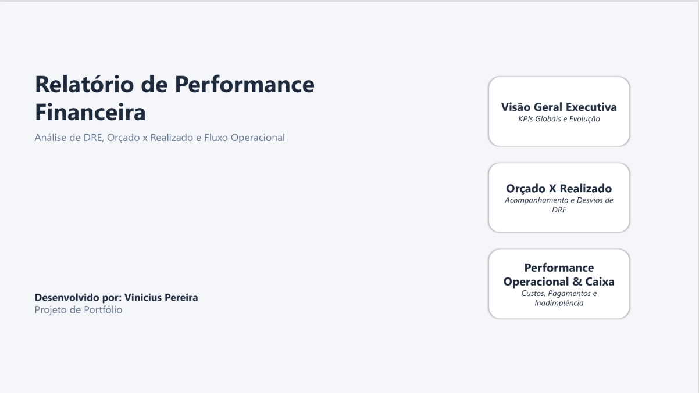
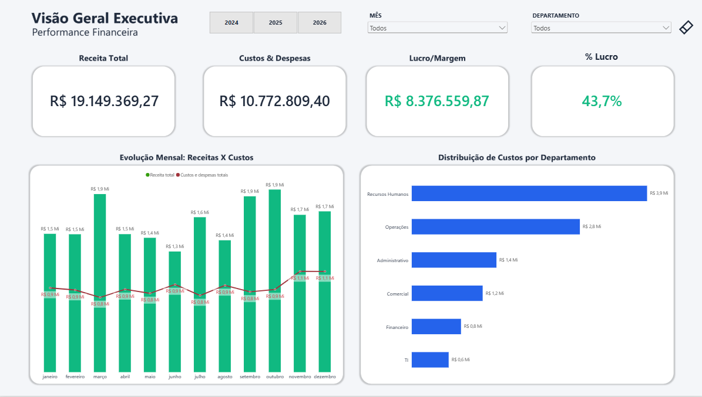
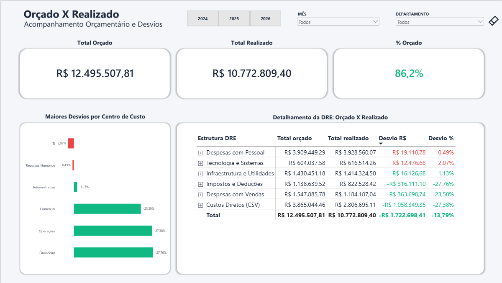
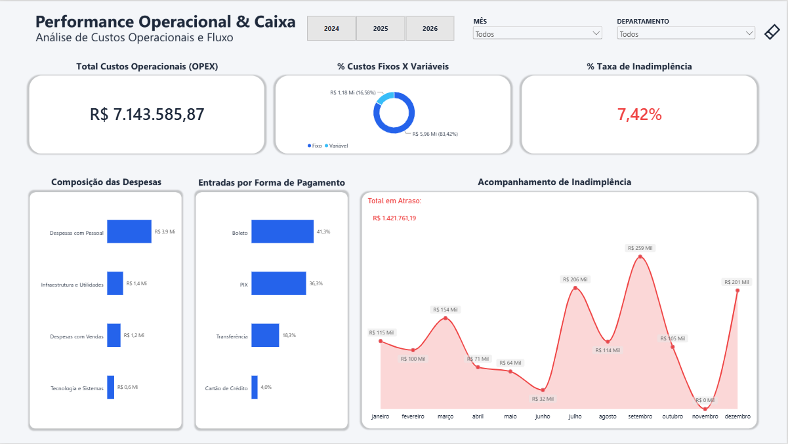

# 📊 Relatório Executivo de Performance Financeira & Gestão de Risco

## 🎯 Visão Geral do Projeto
Desenvolvimento de uma suíte executiva de dashboards interativos no Power BI voltada para o suporte à tomada de decisão C-Level (CFOs e Diretores Financeiros). O projeto aborda a jornada completa dos dados: desde a DRE macro, acompanhamento de Orçado x Realizado, até a gestão de custos operacionais (OPEX), formas de pagamento e indicadores de inadimplência.

---

## 🖼️ Visualização do Dashboard

### 🔹 Capa & Navegação Interativa

### 🔹 Página 1: Visão Geral Executiva (DRE)

### 🔹 Página 2: Orçado X Realizado

### 🔹 Página 3: Performance Operacional & Caixa

---

## 💡 Insights Financeiros e de Negócio

### 1. Performance Global & Margens (Página 1)
* **Receita Acumulada:** R$ 19,15 Mi com Margem de Lucro sólida de **43,7%** (Lucro de R$ 8,38 Mi).
* **Distribuição por Departamento:** Recursos Humanos representa o maior peso na estrutura de custos (R$ 3,9 Mi), seguido por Operações (R$ 2,8 Mi).

### 2. Governança Orçamentária & Desvios (Página 2)
* **Execução Orçamentária Geral:** Aderência global de **86,2%** do orçamento, com gasto realizado de R$ 10,77 Mi frente a R$ 12,50 Mi orçados, gerando uma economia operacional líquida de **R$ 1,72 Mi (-13,79%)**.
* **Mapeamento de Estouros (Over-budget):** Identificação de desvios críticos em **Tecnologia e Sistemas (+2,07% / +R$ 12,5 mil)** e **Despesas com Pessoal (+0,49% / +R$ 19,1 mil)**, sinalizando necessidade de reajuste nas premissas orçamentárias desses centros de custo.
* **Geração de Eficiência (Under-budget):** Expressiva economia em **Custos Diretos (-27,38% / -R$ 1,06 Mi)** e **Impostos e Deduções (-27,76% / -R$ 316,1 mil)**, otimizando a margem operacional.

### 3. Gestão de OPEX, Liquidez & Risco (Página 3)
* **Estrutura de Custos:** Custos variáveis correspondem a **83,4%** do OPEX Total (R$ 7,14 Mi).
* **Canais de Entrada:** Alta concentração em meios instantâneos e de liquidez direta: **Boleto (41,3%)** e **PIX (36,3%)** somam **77,6%** do caixa gerado.
* **Gestão de Risco:** Taxa média de inadimplência em **7,42%** (R$ 1,42 Mi em atraso), com análise temporal identificando pico crítico em setembro (R$ 259 mil), permitindo ações preventivas de cobrança.

---

## 🏗️ Arquitetura de Dados & Modelagem

* **Esquema de Dados:** Modelagem dimensional em *Fact Constellation Schema* (Star Schema estendido para Orçado x Realizado) com relacionamentos `1 : N` de sentido único, preservando integridade e performance.
* **Tabelas Fato:** `fFinanceiro` (Transações realizadas) e `fOrcamento` (Metas por período/centro de custo).
* **Dimensões Compartilhadas:** `dCalendario` e `dCentroCusto`.

---

## 🎨 UX/UI & Semântica Visual (*Color with Purpose*)

* **Grid & Layout Modular:** Fundos vetorizados e renderizados em PowerPoint para otimizar tempo de carregamento e simetria visual.
* **Navegação:** Hotspots e botões transparentes garantindo interatividade sem poluição visual.
* **Cores Semânticas:**
  * 🟢 **Verde Esmeralda (`#10B981`):** Indicadores de resultado positivo, receita e lucro.
  * 🔵 **Navy / Azul Royal (`#1E293B` / `#2563EB`):** Estrutura, custos operacionais e fluxo padrão.
  * 🔴 **Vermelho Alerta (`#EF4444`):** Restrito estritamente a indicadores de risco e inadimplência.

---

## 🛠️ Tecnologias Utilizadas
* **Power BI Desktop** (Visualização e Modelagem)
* **DAX** (Métricas de variação percentual, cálculos de acúmulo temporais e inteligência orçamentária)
* **Power Query / M** (ETL, transformação e limpeza de dados)
* **Microsoft PowerPoint** (UI Design & Wireframing de layouts vetorizados)

---

## 📌 Nota sobre os Dados
* O arquivo `.pbix` na pasta `/pbix` já acompanha os dados de exemplo embutidos para visualização imediata. Caso deseje atualizar os registros localmente, utilize a base disponível na pasta `/base`.

---

## 👤 Autor
Desenvolvido por **Vinicius Pereira**  
[LinkedIn](https://www.linkedin.com/in/vinicius-pereira-a92689172)